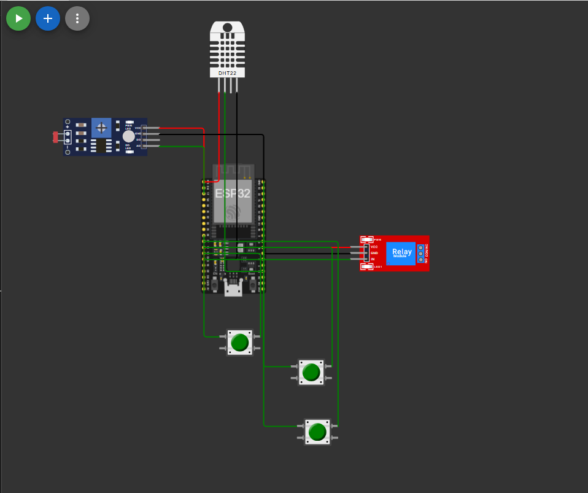

# FarmTech Solutions - Sistema de Irrigação Automatizado (Fase 2)

## 📌 Sobre o Projeto
Protótipo de sistema de irrigação inteligente focado no cultivo de **Tomateiro**, desenvolvido pela equipe da **FarmTech Solutions**.

O sistema monitora em tempo real a umidade do solo, pH simulado via sensor LDR e presença de nutrientes NPK, acionando uma bomba d'água via módulo relé para irrigação automatizada[cite: 1].

---

## 🌽 Cultura Agrícola Escolhida: Tomate
* **Umidade do Solo Ideal:** Abaixo de 65% (aciona a irrigação)[cite: 1].
* **pH do Solo Ideal:** Entre 6.0 e 6.8[cite: 1].
* **Nutrientes (NPK):** Nitrogênio, Fósforo e Potássio (simulados por 3 botões)[cite: 1].

---

## 🛠️ Mapeamento e Componentes
| Componente Real | Componente Simulado no Wokwi | Função no Projeto |
| :--- | :--- | :--- |
| **Bomba de Irrigação** | Módulo Relé (pino 26) | Ativa ou desativa a irrigação[cite: 1]. |
| **Umidade do Solo** | Sensor DHT22 (pino 15) | Mede a umidade percentual[cite: 1]. |
| **pH do Solo** | Módulo LDR (pino 34) | Mapeia iluminação para escala de pH (0 a 14)[cite: 1, 2]. |
| **Nutrientes N, P, K** | 3 Pushbuttons (pinos 12, 14, 27) | Representam estado dos nutrientes NPK[cite: 1]. |
| **Microcontrolador** | ESP32 | Executa a lógica de controle[cite: 1]. |

---

## ⚙️ Lógica de Decisão
A bomba de irrigação (Relé) aciona **apenas** quando:
1. Umidade < 65%[cite: 1].
2. pH entre 6.0 e 6.8[cite: 1].
3. Os 3 botões NPK estiverem acionados[cite: 1].

---

## 🖼️ Circuito do Projeto

---

## 🎬 Vídeo Demonstrativo
Assista à demonstração completa da simulação no YouTube:
[Link do Vídeo no YouTube - FarmTech Solutions](https://youtu.be/tjdUr5gz4TE)

---

## 👨‍💻 Integrantes do Grupo
* Eduardo Kenzo Dantas Yosimoto - RMxxxxx